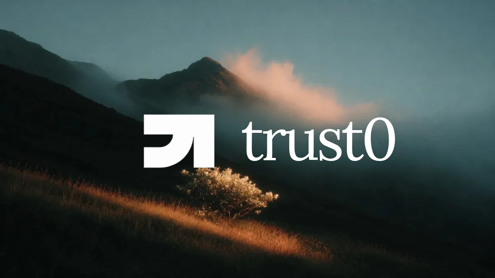

# trust0

### The trust layer for everything you see online.



[Open the studio](https://studio.trytrust0.online/) · [GitHub](https://github.com/siddhantprateek/trust0)

AI-generated images, recycled videos and confident-sounding AI answers spread faster than anyone can check them. **trust0 tells you if something can be trusted, where it came from, and why.**

Paste a link, upload a photo or video, or drop in some text. In about a minute you get a clear verdict, a 0-100 trust score, and the receipts.

---

## The problem

Spend 5 minutes on Instagram, X, or a WhatsApp group and you'll come across something you can't identify. Is that a real photo or one from Midjourney? Is that a video from today or three years ago in another country? Is ChatGPT correct, or simply confident? Normally, you cannot know. After a while, you begin to suspect that everything you see online is a forgery, and you stop believing anything.

You've probably seen all of these:

- A viral video turns out to be 3 years old, from another country.
- A "photo" of a news event was generated by Midjourney.
- An AI chatbot states something false with total confidence, and the screenshot spreads as proof.

Checking any of them entails performing a reverse image search on Google Lens, going back through reposts for the original poster, reading two or three fact-checking websites, and then guessing. That's nearly 20 minutes for a post that you'll skip in 4 seconds, so almost no one bothers. trust0 completes that task in roughly a minute and returns a 0-100 trust score along with the reasons for it.

## What you get

Submit an Instagram reel, an X video, a TikTok, a YouTube link, a Reddit post, an article, a photo or plain text, and trust0 shows you:

| | |
|---|---|
| **A verdict and trust score** | Authentic, edited, likely AI-generated, accurate, mixed, inaccurate or unverified, with a score from 0 to 100 |
| **The spread path** | Where the content first appeared and how it reached the post you're looking at: original poster, reuploads, edits |
| **AI-generated media check** | Is this image or video made by an AI? Two independent detectors plus a second-opinion model must agree before we say "likely AI" |
| **Fact check** | The key claims in the post, each checked against primary sources and published fact checks, with links |
| **Coverage and bias** | For news: how outlets across the political spectrum are covering the story, and any blind spots |
| **Plain-English reasons** | Every point added or removed from the score matches a check you can see. No black box |

## Use it where you already are

- **Browser extension.** A small trust chip appears on ChatGPT, Claude, Gemini and Perplexity answers, on X, Instagram, Reddit and LinkedIn posts, on WhatsApp Web messages, and on YouTube, TikTok and articles. Click it to see the verdict. Right-click anything (text, image, video, link) and choose **Check with trust0**.
- **Studio dashboard.** Run checks, open full reports with the spread path and sources, track checks that are still running, and choose which sites the extension scans automatically.
- **Public API.** Send an image to our own AI-image detector, **t0-vision**, and get back a probability it's AI-generated.

## How it works

```
ingest -> fingerprint -> provenance -+-> fact check -> coverage & bias -> score
                     \-> AI detection -/
```

1. **Ingest** the post, video, captions and transcript.
2. **Fingerprint** the media so it can be matched even after re-encoding, cropping or compression.
3. **Trace** it back to the earliest appearance using visual matches, platform metadata, reverse image search and web research.
4. **Detect AI generation** with t0-vision (our fine-tuned detector), Hive, content-credential (C2PA) markers and a visual review by TypeSafe's Jev.
5. **Fact check** the claims with an LLM (Claude, OpenAI or OpenRouter) that searches the live web.
6. **Compare coverage** across outlets and rate their lean.
7. **Score** with transparent rules.

We are careful about false accusations. "Likely AI" requires two signals that agree, and when the detectors and the visual review disagree we say **unverified** and show both numbers. Downloaded media is deleted when a check finishes; only anonymous hashes are kept.

### Our own model: t0-vision

We benchmarked open-source AI-image detectors on 1,380 images (450 real: 300 ImageNet photos and 150 FFHQ faces; 930 AI from 11 generators). Every image was scored three ways: as downloaded, **social** (1080 px, JPEG q75, like an X or Instagram upload) and **repost** (shrunk to 720 px and recompressed, like a screenshot of a repost). Measured on an RTX 3080 Laptop, 2026-10-05.

#### Results

<p align="center"></p>

AUC: 0.5 is a coin toss, 1.0 is perfect. "Caught" and "flagged" use a 0.5 threshold on the social condition.

| Model | AUC (original / social / repost) | AI caught | Real flagged as AI | ms/img |
|---|---|---|---|---|
| **t0-vision (ours)** | **0.94 / 0.98 / 0.99** | **84%** | **6%** | 22 |
| Smogy/SMOGY-Ai-images-detector | 0.84 / 0.69 / 0.68 | 79% | 31% | 9 |
| Ateeqq/ai-vs-human-image-detector | 0.70 / 0.70 / 0.77 | 56% | 21% | 8 |
| umm-maybe/AI-image-detector | 0.60 / 0.61 / 0.62 | 40% | 12% | 9 |

#### Detection rate by generator (social condition)

<p align="center"></p>

| Generator | **t0-vision** | Smogy | Ateeqq | umm-maybe |
|---|---|---|---|---|
| FLUX.2-dev | **97%** | 64% | 81% | 22% |
| FLUX.1-dev | **100%** | 90% | 95% | 25% |
| FLUX.1-dev faces | 93% | **94%** | 76% | 59% |
| Midjourney v6 | **100%** | 71% | 63% | 11% |
| Midjourney v5 | **100%** | 58% | 58% | 22% |
| SD 1.5 | 90% | 83% | 50% | 48% |
| Older (ADM, BigGAN, GLIDE, VQDM, Wukong) | 15-100% | **77-95%** | 0-67% | 42-68% |
| **Real faces wrongly flagged (lower is better)** | **0%** | 89% | 7% | 56% |

<p align="center"></p>

**Takeaways**
- **t0-vision** has the best AUC in every condition and gets better, not worse, on compressed and reposted images, which is how content actually looks in the wild. It catches 97-100% of the newest generators (FLUX, Midjourney) and never flagged a real face in the social test.
- Its weak spot is a few older research generators (ADM, VQDM), which are rare in real-world posts.
- **Smogy** catches a lot, but calls 89% of real faces AI and falls apart once images are compressed. Its catch rate is mostly "flag everything".
- **Ateeqq** is strong on Flux, weak on older generators. **umm-maybe** is close to a coin toss.

A detector that cries wolf is worse than none, so t0-vision was fine-tuned on roughly 400 GB of real and AI images, with random JPEG compression and downscaling so it learns images the way they look after social media, while keeping false alarms low. Reproduce the benchmark and the training run from [`experiments/`](experiments/README.md).

This is a quick sanity check, not a formal benchmark: the set is small and the real photos are mostly ImageNet.

## Try it

You need Python 3.11+, Node 20+ and [ffmpeg](https://ffmpeg.org) on your `PATH`.

**1. Start the API**

```bash
cd src
python -m venv .venv
source .venv/bin/activate          # Windows: .venv/Scripts/activate
pip install -e ".[dev]" "yt-dlp[default]"
cp .env.example .env               # add the API keys you have
uvicorn app.main:app --reload --port 8000
```

Every key is optional. A check simply skips any stage whose key is missing and tells you which. More keys means deeper checks (see [`src/README.md`](src/README.md)).

**2. Start the studio**

```bash
cd studio
npm install
cp .env.example .env.local         # add your Clerk key; API URL defaults to localhost:8000
npm run dev
```

**3. Install the extension**

Open `chrome://extensions`, turn on Developer mode, click **Load unpacked** and choose the `plugin/` folder. Works in Chrome, Edge, Brave and Arc.

## Built with

FastAPI, yt-dlp, ffmpeg, Hugging Face Transformers (SwinV2, Whisper), Claude / OpenAI web search, SerpAPI, Google Fact Check, Hive, TypeSafe Jev, React, Vite, Tailwind, shadcn/ui, Clerk, and a Manifest V3 Chrome extension.

## Repository map

| Folder | Contents |
|---|---|
| [`src/`](src/README.md) | API and check pipeline |
| [`studio/`](studio) | Dashboard |
| [`plugin/`](plugin/README.md) | Browser extension |
| [`web/`](web) | Landing site |
| [`experiments/`](experiments/README.md) | Detector benchmarks and training |
| [`docs/`](docs) | Notes and the [Jev integration](docs/jev.md) |

## What's next

- Sign-in and rate limiting on the API
- A job queue so checks survive restarts
- A faster hash index for matching at scale
- More trust0 models beyond images
