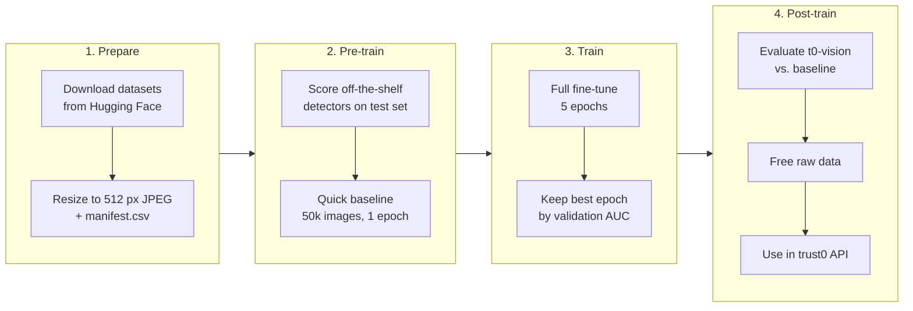

**t0-vision** is trust0's AI-image detector. It starts from `haywoodsloan/ai-image-detector-deploy` (SwinV2), which scored best of the off-the-shelf detectors we tested (see `../README.md`), and is fine-tuned on ~400 GB of real and AI-generated images so it holds up on images as they look after X, Instagram and repost compression.

The name and checkpoint folder are set in `sources.py` (`MODEL_NAME`, `MODEL_DIR`).



All commands run from `experiments/ai-detect/` with the venv active. Every step is resumable: stop with Ctrl+C and rerun the same command.

> **Git Bash:** use forward slashes in Windows paths (`C:/trust0-data/...`). Backslashes are eaten by the shell, so `C:\trust0-data` arrives as `C:trust0-data`.

## Where things live

| What | Path | Size |
|---|---|---|
| Raw downloads (GenImage, FLUX.2, FLUX.1 faces, FFHQ real) | `D:/trust0-data/raw/` | ~334 GB |
| Raw downloads (Midjourney v6) | `C:/trust0-data/raw/` | ~74 GB |
| Prepared training images + `manifest.csv` | `C:/trust0-data/prepared/` | ~146 GB |
| Checkpoints | `C:/trust0-data/checkpoints/t0-vision/{last,best}` | ~1 GB |
| Test set (1,380 images, never trained on) | `data/` + `manifest.csv` | 366 MB |

## 1. Prepare

**Download.** Sources and per-source size budgets are in `sources.py`.

```bash
python download_data.py --dry-run     # what would be downloaded
python download_data.py --parallel 8  # or one source: download_data.py flux2
```

`run_pipeline.cmd` runs the download and the conversion together, writing `logs/download.log` and `logs/prepare.log`.

**Convert.** Every image, real or AI, is re-encoded the same way (longest side 512 px, JPEG q95) so the model can't learn file format as a shortcut. Anything identical to a test image is dropped, and 2% goes to a validation split.

```bash
python prepare_data.py --workers 6
```

Check the summary it prints: both `real` and `ai` should have large counts, and there should be no `!! rows had no recognisable label` lines.

## 2. Pre-train

**Score the starting point.** This runs the off-the-shelf detectors on the test set under three conditions (original, social-media compression, repost of a screenshot) and writes `results.json`. These are the numbers t0-vision has to beat.

```bash
./eval.sh            # PowerShell: .\eval.ps1   (add --fetch / -Fetch to download the test set first)
```

**Quick baseline.** One epoch on 50k images (~1 h) to catch problems before the long run. Loss should fall and accuracy rise in the log every 50 steps.

```bash
python train.py --subset 50000 --epochs 1
python run_eval.py C:/trust0-data/checkpoints/t0-vision/best
```

## 3. Train

```bash
python train.py            # 5 epochs on everything
python train.py --resume   # continue from checkpoints/t0-vision/last after an interruption
```

What happens:
- Real and AI images are sampled 50/50 per batch (the raw mix is mostly AI).
- Training images are randomly JPEG-compressed, downscaled, cropped and flipped, so the model learns from images the way they look after social media.
- After each epoch it reports validation and test-set AUC, then saves `last`, and `best` if validation AUC improved.

GPU memory: the default batch is 16 with 2 accumulation steps (same as a batch of 32). If it runs out of memory on the 16 GB RTX 3080:

```bash
python train.py --batch-size 8 --grad-accum 4
python train.py --batch-size 8 --grad-accum 4 --grad-checkpointing   # less memory, ~30% slower
```

Close other GPU apps (games, launchers, overlays) before a long run.

## 4. Post-train

**Evaluate.** It's listed as `t0-vision/best` in `results.json`, next to the off-the-shelf models.

```bash
python run_eval.py C:/trust0-data/checkpoints/t0-vision/best
```

Target: test AUC above the starting model's 0.83 on all three conditions, with real photos wrongly flagged staying at about 5% or lower.

**Free disk space** (~408 GB) once you're happy with the model. Keep `prepared/` if you may retrain.

```powershell
Remove-Item -Recurse -Force D:\trust0-data\raw, C:\trust0-data\raw
```

**Use it.** Load with `AutoModelForImageClassification.from_pretrained("C:/trust0-data/checkpoints/t0-vision/best")`. The next phase wires it into the API's AI-detection stage (`src/app/services/external.py`) next to, or in place of, Hive.

## Troubleshooting

| Error | Cause | Fix |
|---|---|---|
| `DLL load failed while importing _C: An Application Control policy has blocked this file` | Windows Smart App Control blocks PyTorch's unsigned DLLs | Windows Security → App & browser control → Smart App Control → Off, or run in WSL2 |
| `torch.OutOfMemoryError: CUDA out of memory` | Batch too large for the GPU | Lower `--batch-size`, raise `--grad-accum`, add `--grad-checkpointing` |
| `Repo id must be in the form 'repo_name'...` | Path mangled (backslashes in Git Bash) or wrong folder | Use `C:/trust0-data/checkpoints/t0-vision/best` |
| `getaddrinfo failed` during download | Network dropped | Rerun `download_data.py`; finished shards are skipped |
